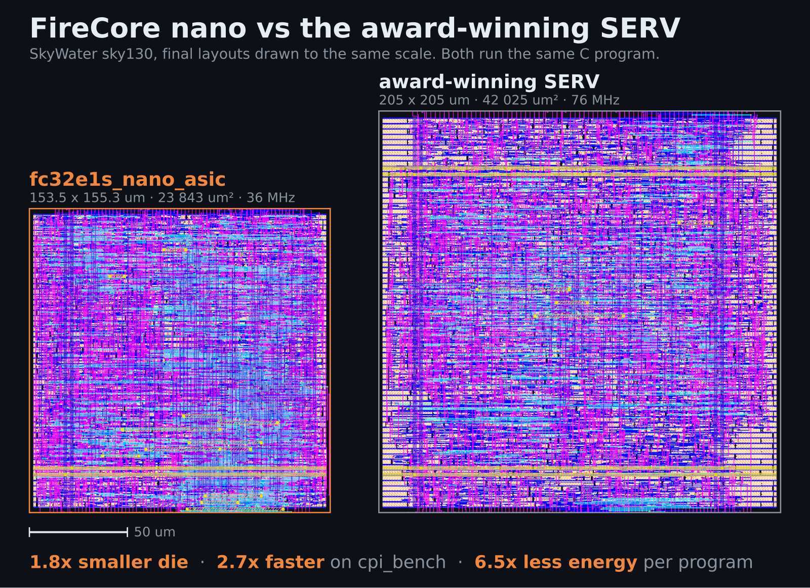
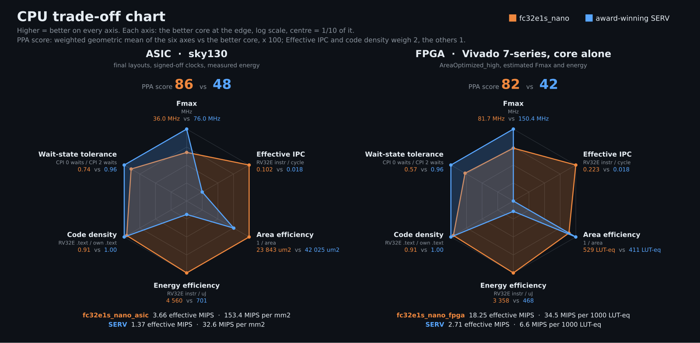
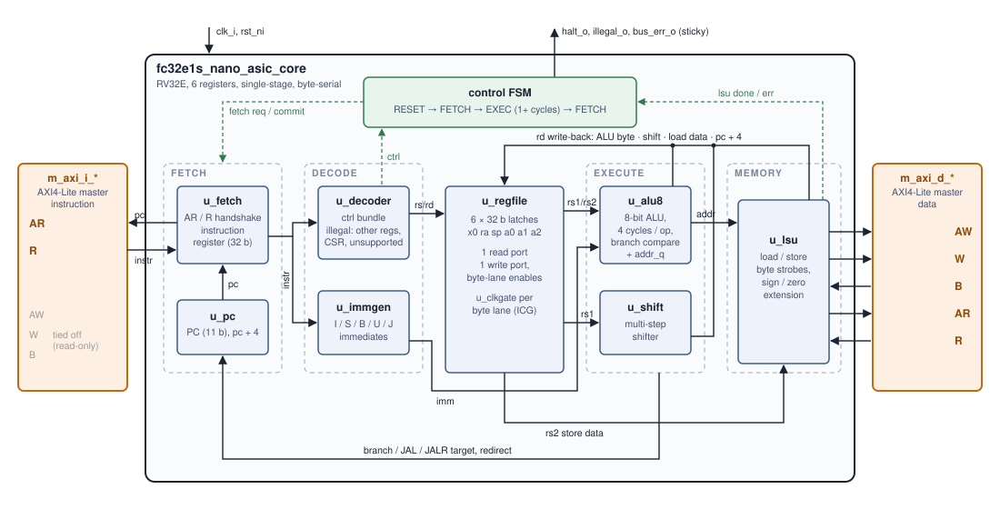

# FireCore nano

The smallest cores of the FireCore RISC-V family: **fc32e1s_nano**, a single-stage RV32E core
that keeps only the 6 registers a C program needs (x0, ra, sp, a0..a2). It comes in two builds of
the same core, one for FPGAs and one for ASICs, and is compared against
[SERV](https://github.com/olofk/serv), the well-known bit-serial RISC-V core.

Only the non-compressed nano cores are published here (no RV32C variants).





PPA score (six axes vs the better core, effective IPC and code density weigh 2):
**ASIC 86 vs 48, FPGA 82 vs 42**. Numbers, method and layouts: [`results/`](results/).
Core structure: [Architecture](#architecture).

## Repository structure

```
fire_core_nano/
├── README.md          this file
├── LICENSE            MIT (third-party code keeps its own license)
├── cores/
│   ├── fc32e1s_nano_fpga/   FPGA build: 32-bit ALU, register file in LUTRAM
│   ├── fc32e1s_nano_asic/   ASIC build: byte-serial ALU, latch register file, sky130 flow
│   └── serv/                SERV (Olof Kindgren, ISC), the reference core, with our sky130 flow
├── common/            shared RTL and testbench models (memories, latch register file)
├── bench/cpi_test/    one C CPI test for every core (nano FPGA / ASIC, SERV, FPGA board tops)
├── bench/power/       sky130 CPU power from the CPI test's gate-level switching activity
├── results/           FireCore nano vs SERV: sky130 layouts, FPGA synthesis, CPI
├── toolchain/         riscv32-nano-elf: GCC 13.2 with -mnano + picolibc (patches, build, tests)
└── sw/                C for the nano cores: BSP, Makefile, hello example
```

Each core directory has the same layout:

| Directory | Contents |
|---|---|
| `rtl/` | SystemVerilog sources, `HISTORY` (revisions) |
| `verif/` | verification environment (Spike ISS vs RTL) |
| `appl/` | implementation flows (Gowin GW2A project, Vivado, LibreLane sky130) |
| `example/`, `sw/` | example subsystem and its software (ASIC build) |

## Cores

| Core | ISA | Registers | Datapath | Target |
|---|---|---|---|---|
| `fc32e1s_nano_fpga` | RV32E | 6 | 32-bit ALU, one cycle per ALU op | FPGA (Gowin GW2A, Xilinx 7-series) |
| `fc32e1s_nano_asic` | RV32E | 6 | byte-serial ALU (4 cycles per ALU op), latch register file | ASIC (SkyWater sky130) |
| `serv` | RV32I / RV32E | 32 / 16 | bit-serial | reference |

Name: **fc** FireCore, **32** XLEN, **e** RV32E, **1s** single-stage (one instruction in flight),
**nano** 6-register variant.

## Architecture



Both builds are the same core: one instruction at a time, a fetch and then one or more execute
cycles, with no pipeline and no overlap.

```
RESET -> FETCH --(R handshake)--> EXEC (1+ cycles) --(commit)--> FETCH
           |                        |
           +-- bus error --> HALT <-+-- ECALL / EBREAK / illegal / bus error
```

- **Two AXI4-Lite masters**: `m_axi_i_*` fetches instructions (read-only, write channels tied
  off), `m_axi_d_*` does loads and stores. Any handshake may stall; the core holds no memory.
- **Fetch → decode → execute → memory**: `fetch` puts the instruction in a 32-bit register,
  `decoder` and `immgen` decode it from there, then the ALU, the multi-step shifter or the
  `lsu` (byte strobes, sign / zero extension) runs it. Commit writes rd and the PC in one edge.
- **6 registers**: x0, ra, sp, a0..a2 exist (5 physical words). An instruction that names any
  other register is illegal, so a stock-compiled program stops at once instead of running wrong;
  `-mnano` code never names one.
- **PC** is 11 bits (2 KiB of code, `PC_W`); 32 for the Spike testbench.
- **Not implemented**: CSRs, interrupts, traps, misaligned access, FENCE.I. ECALL / EBREAK
  raise `halt_o`, an unsupported encoding `illegal_o`, a bus SLVERR / DECERR `bus_err_o`; all
  three are sticky and stop the core until reset.

The builds differ only where FPGA and ASIC cost differ:

| | `fc32e1s_nano_fpga` | `fc32e1s_nano_asic` |
|---|---|---|
| ALU | 32-bit, 1 cycle per op | 8-bit, rd written one byte per cycle: 4 cycles with an immediate, 8 register-register |
| Branch compare | carry-chain comparator, 1 cycle | in the byte ALU, 8 cycles |
| Register file | LUTRAM (4 byte-wide RAM16s), 2 read ports | latches, one clock gate per byte lane, 1 read port (rs2 read first, then rs1) |
| Shifts | 1 cycle per step | 1 cycle per step, +1 for a shift by a register |
| CPI (`cpi_bench`, zero wait states) | 3.37 | 7.40 |

Per-core details, cycle counts and results: [`cores/fc32e1s_nano_fpga`](cores/fc32e1s_nano_fpga),
[`cores/fc32e1s_nano_asic`](cores/fc32e1s_nano_asic).

## Writing C for the nano cores

A stock RISC-V compiler uses registers the nano cores do not have. **`-mnano`** is a GCC 13.2
option that compiles C for exactly x0, ra, sp, a0..a2 (3 argument registers, the rest on the
stack), with libgcc and picolibc built for it.

```sh
# prebuilt, any x86_64 Linux or WSL (statically linked)
mkdir -p $HOME/opt && tar xf riscv32-nano-elf-*-x86_64-linux.tar.xz -C $HOME/opt
export PATH=$HOME/opt/riscv32-nano/bin:$PATH
cd sw && make            # hello world for the FPGA subsystem -> build/fpga/
```

- Download: [releases](https://github.com/BekiryY/fire_core_nano/releases) (`toolchain-*`).
- Build it yourself, ABI, limits and tests: [`toolchain/`](toolchain/).
- Board support (start-up code, linker scripts, console `printf`) and examples: [`sw/`](sw/).

## Status

All sources, flows and the `-mnano` toolchain ([`toolchain/`](toolchain/)) are in this repo.
`results/sky130/*/config.yaml` are archived copies of the configs that produced the layouts;
run the flows from `cores/*/appl/`.

The comparison with SERV is in [`results/`](results/).

## License

MIT, see [`LICENSE`](LICENSE). `cores/serv/` is SERV by Olof Kindgren under the ISC License
([`cores/serv/LICENSE`](cores/serv/LICENSE)); `serv_compdec.v` is Apache-2.0.
