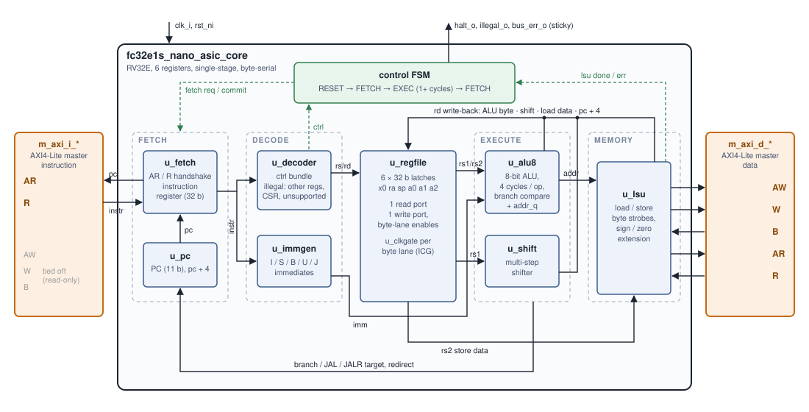

# fc32e1s_nano_asic: RV32E core on 6 registers, ASIC build

A single-stage RV32E core that keeps only the 6 registers a C program needs (x0, ra, sp,
a0..a2), built for area on SkyWater sky130: a byte-serial ALU (4 cycles per ALU operation,
branches compare in it) and a register file in latches behind one clock gate per byte lane.
AXI4-Lite instruction and data ports. Software: `riscv32-nano-elf-gcc -mnano`
([`../../toolchain`](../../toolchain)). FPGA build of the same core:
[`fc32e1s_nano_fpga`](../fc32e1s_nano_fpga).



Single-stage and multi-cycle: one instruction at a time, a fetch then 1 or more execute cycles.

| | |
|---|---|
| sky130 layout (core alone) | 153.5 x 155.3 um = 23 843 um2, 82.7 % density, **36 MHz** signed off in 9 corners |
| Standard cells | 18 505 um2 after layout (Yosys synthesis: 13 614 um2) |
| CPI | 7.40 on `cpi_bench`, zero wait states |
| Power | 0.777 mW at 36 MHz, CPI test activity (tt), [`../../bench/power`](../../bench/power) |
| Verification | Spike vs RTL: 41/41 tests match, 38/38 instructions covered ([`verif/`](verif/)) |

Comparison with SERV: [`../../results`](../../results).

## Run it (from this directory)

```bash
(cd verif/env/spike_iss && ./run_core_tests.sh)     # regression: Spike vs RTL (xsim)
../../bench/cpi_test/run.sh fc32e1s_nano_asic        # CPI test
appl/sky130_core/run_core.sh k1                     # LibreLane sky130 layout (WSL / Linux)
```

Simulate with xsim: Verilator mis-simulates the latch register file.

| Directory | |
|---|---|
| `rtl/` | the core (`fc32e1s_nano_asic_core`), revisions in `rtl/HISTORY` |
| `verif/` | Spike ISS vs RTL regression |
| `appl/sky130_core/` | LibreLane flow of the core alone (`fc32e1s_nano_asic_hard`, define `FC32E1S_NANO_ASIC_SKY130_ICG` for the library clock gate) |
| `appl/gw2a/` | Gowin synthesis of the core alone, to compare with the FPGA build |
| `example/subsystem/`, `sw/` | core + fetch port + boot ROM + 2 KiB RAM, and the boot ROM's source |
