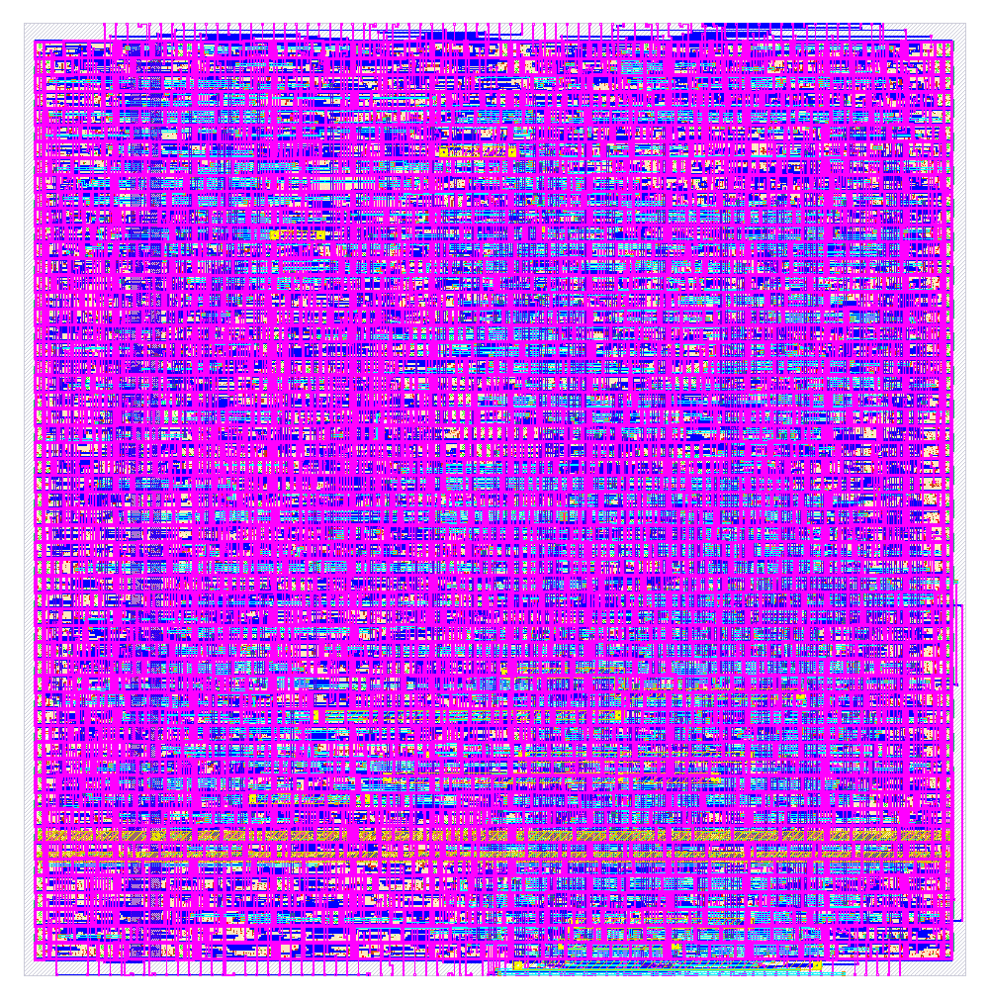
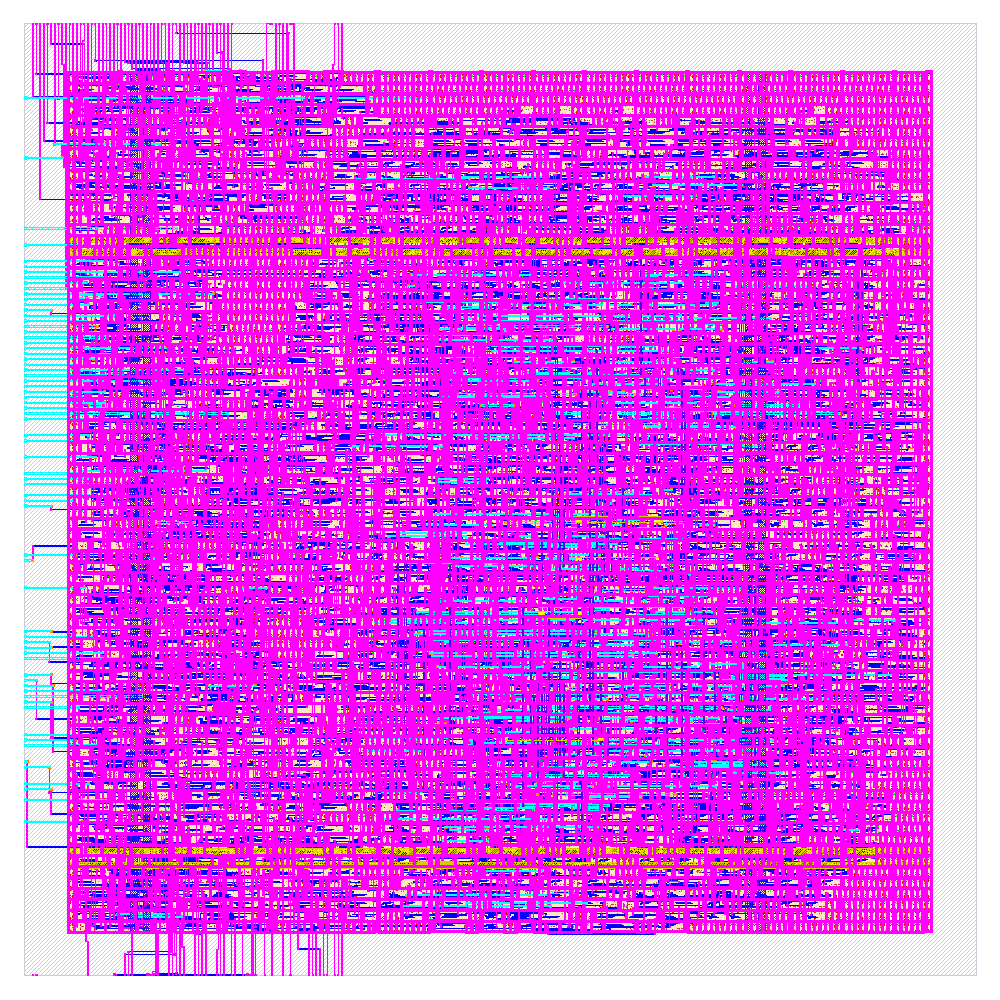

# Results: FireCore nano vs SERV

The FireCore nano core compared with [SERV](https://github.com/olofk/serv) (bit-serial RISC-V,
Olof Kindgren), the usual reference for "smallest RISC-V core", once as an ASIC and once on an
FPGA, each against SERV built for the same target:

| Target | FireCore nano | SERV |
|---|---|---|
| ASIC, SkyWater sky130 | `fc32e1s_nano_asic` (byte-serial ALU, latch register file) | SERV RV32E, latch register file |
| FPGA, Gowin GW2A-18 | `fc32e1s_nano_fpga` (32-bit ALU, LUTRAM register file) | SERV, register file in block RAM |

Date: 2026-11-08.

## Summary

| | ASIC (sky130) | FPGA (GW2A-18) |
|---|---|---|
| nano runs the benchmark | **2.4x faster** (2.1x at equal timing margin) | **5.5x faster** |
| at a clock of | 36 MHz vs SERV's 85 MHz | 61.6 MHz vs SERV's 139.8 MHz |
| size | **2.4x smaller die** | 3.2x more logic (1225 vs 388), 1 block RAM less |
| other | **6.4x less energy** (gate-level activity) | **1.7x more speed per logic cell** |

SERV clocks 2.3-2.4x higher on both, but needs 5.6x (ASIC) and 12.4x (FPGA) more cycles for the
same C program. On sky130 the nano is both smaller and faster; on an FPGA SERV stays the smallest
core and the nano buys 5.5x the speed for 3.2x the logic.

## Software and method

`cpi_bench`: one C program (crc, fib, qsort, bsearch, list, interp, parse kernels), GCC 13.2.0
`-O2`, zero memory wait states. Each core runs its own compiler's code: the nano cores
`riscv32-nano-elf-gcc -mnano` ([`../toolchain`](../toolchain), 6 registers), SERV stock
`riscv64-unknown-elf-gcc -march=rv32e` (16 registers). Raw outputs: [`cpi_bench/`](cpi_bench/).

| Program | Code (.text) | Instructions |
|---|---|---|
| nano (`-mnano`, 6 registers) | 5 460 B | 1 465 222 |
| SERV (RV32E, 16 registers) | 4 972 B | 1 101 473 |

With 6 registers the program is 9.8 % larger and runs 33 % more instructions; every cycle count,
time and MIPS figure below includes that.

- **Complete time** = cycles / clock.
- **Effective MIPS** = the program's work in RV32E instructions (SERV's count, 1 101 473) /
  complete time, so the nano's extra instructions count against it. Native MIPS = the core's
  own instructions / time = clock / CPI.

The small CPI test in [`../bench/cpi_test`](../bench/cpi_test) (1 KiB image, same compilers) runs
on every core and board top of this comparison and agrees with `cpi_bench`.

## ASIC: fc32e1s_nano_asic vs SERV on sky130

SkyWater sky130A, `sky130_fd_sc_hd`, LibreLane Classic flow, signed off in all 9 corners
(ss / tt / ff x min / nom / max RC). Both cores are standard cells only (no SRAM macro); the
layouts are the core with its bus pins. Configs and metrics are in [`sky130/`](sky130/).

| | fc32e1s_nano_asic | SERV, RV32E |
|---|---|---|
| ISA, registers | RV32E, 6 (x0 ra sp a0..a2) | RV32E, 16 (x0..x15) |
| Datapath | byte-serial ALU | bit-serial |
| Register file | latches, one clock gate per byte lane | latches (`dlxtp_1`), one clock gate per word |
| Die | 153.5 x 155.3 um = **23 843 um2** | 238 x 238 um = **56 644 um2** |
| Standard cells | **18 505 um2** | **30 895 um2** |
| of which sequential | 5 095 um2 | 13 992 um2 |
| Cell density (fill excluded) | 82.7 % | 66.6 % |
| Clock (signed off) | **36 MHz** (ss Fmax 37.0 MHz, max RC) | **85 MHz** (ss setup slack +1.59 ns) |
| Hold, worst | +0.106 ns | +0.0015 ns |
| DRC (Magic, KLayout) / LVS / antenna | clean | clean |
| Max slew (1.1 ns limit) | 1 net at 1.13 ns (ss) | clean |
| Wire length | 67.7 mm | 68.8 mm |
| Power, CPI test activity (tt) | **0.777 mW** at 36 MHz | **2.279 mW** at 85 MHz |
| Power, vectorless (OpenSTA / LibreLane) | 1.95 / 2.33 mW | 4.82 / 5.71 mW |

| fc32e1s_nano_asic | SERV, RV32E |
|---|---|
|  |  |
| 153.5 x 155.3 um | 238 x 238 um (images are not to the same scale) |

Performance, `cpi_bench`, at each core's signed-off clock:

| | fc32e1s_nano_asic | SERV, RV32E | nano advantage |
|---|---|---|---|
| Cycles | 10 839 619 | 61 037 635 | 5.6x fewer |
| CPI | 7.40 | 55.42 | |
| Complete time | 10.84 M / 36 MHz = **301 ms** | 61.04 M / 85 MHz = **718 ms** | 2.39x faster |
| Effective MIPS | **3.66** | **1.53** | 2.39x |
| Native MIPS | 4.87 | 1.53 | |
| Code (.text) | 5 460 B | 4 972 B | 1.10x larger |
| Die area | 23 843 um2 | 56 644 um2 | 2.38x smaller |
| Speed per die area | | | 5.7x |
| Energy, from the CPI test's energy per cycle | 21.6 pJ x 10.84 M = **234 uJ** | 26.8 pJ x 61.04 M = **1637 uJ** | 7.0x less |

CPI test: nano 36 392 cycles, 1.01 ms (3.49 effective MIPS); SERV 183 729 cycles, 2.16 ms
(1.63); 2.1x.

**Energy, measured.** `cpi_bench` (5.5 KiB) does not fit the nano layout's 2 KiB instruction
space, so the energy is measured with the CPI test, which runs on both final netlists:
gate-level simulation at the signed-off clock, every cell pin's toggles recorded (SAIF), OpenSTA
with the layout's parasitics at tt 025C 1v80 ([`../bench/power`](../bench/power), reports in
[`power/`](power/)). CPU only: the memory is outside the netlists.

| CPI test, reset to end | fc32e1s_nano_asic | SERV, RV32E | |
|---|---|---|---|
| Cycles / instructions | 38 066 / 5 482 | 196 149 / 3 744 | |
| Time | 1057 us at 36 MHz | 2307 us at 85 MHz | |
| Power | **0.777 mW** (sequential 0.208, combinational 0.370, clock 0.199) | **2.279 mW** (sequential 1.243, combinational 0.215, clock 0.821) | |
| Energy | **0.821 uJ** | **5.259 uJ** | **6.4x less** |
| per cycle | 21.6 pJ | 26.8 pJ | 1.24x less |
| per instruction | 150 pJ | 1405 pJ | |

The real activity is 2.5x (nano) and 2.1x (SERV) lower than the vectorless estimates. SERV
spends more energy per cycle (most of it in its sequential cells and its clock tree)
and needs 5.2x the cycles. The energy per program does not depend on the clock (power scales
with it), so the equal-margin comparison changes only the time, not the energy.

- **Clock margins differ.** At the slow corner (ss 100C 1.60 V, max RC) SERV runs 85 MHz against
  an Fmax of about 98 MHz (13.5 % margin), the nano 36 MHz against 37.0 MHz (2.7 %; 39.5 MHz at
  min RC). Compared at their Fmax, or both at 13.5 % margin (nano 32 MHz), the nano finishes
  `cpi_bench` **2.1x** sooner (293 vs 621 ms) instead of 2.4x.
- **Densities differ.** SERV was laid out at 60-67 % cell density, the nano at 82.7 %. At the
  nano's density SERV's die would be about 46 400 um2, still 1.9x the nano's.
- **Power** is simulation-annotated at the typical corner with zero-delay activity (no glitches,
  so combinational switching is a lower bound), not a silicon measurement. `cpi_bench`'s energy
  is the CPI test's energy per cycle times `cpi_bench`'s cycles.
- **SERV configuration.** Upstream SERV with `WITH_CSR = 0` (no CSRs, traps or timer interrupt;
  the nano has none either), `W = 1`, RV32E (registers x0..x15), and its register-file RAM
  replaced by a latch register file (`common/rtl/regfile/rf32x32_2r1w_latch.sv`). The latch
  register file does not change SERV's timing in cycles: an RV32I build runs `cpi_bench` in
  exactly the stock SERV cycle count.

## FPGA: fc32e1s_nano_fpga vs SERV on GW2A-18

Gowin GW2A-LV18PG256C8/I7, Gowin EDA 1.9.12.04, synthesis and place and route with the same
strategy for both ([`gw_project.tcl`](../cores/fc32e1s_nano_fpga/appl/gw2a/gw_project.tcl):
area goal, max fanout 12, 100 MHz constraint, Fmax from the timing report). A bare core has more
pins than the device, so each core is built in the same board top: core + 2 KiB block RAM (code,
data, stack; the same RAM module for both) + LED / counter peripheral + reset synchronizer.

| | fc32e1s_nano_fpga top | SERV top |
|---|---|---|
| Board top | [`fc32e1s_nano_fpga_top.sv`](../cores/fc32e1s_nano_fpga/example/subsystem/fc32e1s_nano_fpga_top.sv) | [`serv_fpga_top.sv`](../cores/serv/example/subsystem/serv_fpga_top.sv) |
| Logic | **1225** (963 LUT, 166 ALU, 16 RAM16) | **388** (307 LUT, 69 ALU, 2 RAM16) |
| Registers | 171 | 281 |
| Block RAM | 4 (the 2 KiB RAM) | 5 (the 2 KiB RAM + the register file) |
| Fmax | **61.6 MHz** | **139.8 MHz** |

The core alone (synthesis, no place and route): nano 963 logic (769 LUT, 98 ALU, 16 RAM16), 58
registers; SERV (`serv_rf_top`, with CSRs) 288 LUT, 182 FF, 1 block RAM.

Performance, `cpi_bench`, at each top's Fmax:

| | fc32e1s_nano_fpga | SERV | nano advantage |
|---|---|---|---|
| Cycles | 4 931 283 | 61 037 635 | 12.4x fewer |
| CPI | 3.37 | 55.42 | |
| Complete time | 4.93 M / 61.6 MHz = **80.0 ms** | 61.04 M / 139.8 MHz = **436.5 ms** | 5.46x faster |
| Effective MIPS | **13.77** | **2.52** | 5.46x |
| Native MIPS | 18.30 | 2.52 | |
| Code (.text) | 5 460 B | 4 972 B | 1.10x larger |
| Logic | 1225 | 388 | 3.16x more |
| Effective MIPS per 1000 logic | 11.2 | 6.5 | 1.73x |

CPI test on the board tops themselves (xsim): nano 18 304 cycles, 297 us (11.87 effective MIPS);
SERV 183 729 cycles, 1314 us (2.68); 4.4x.

- **Fmax is the board top's**, RAM and peripheral included, without pin constraints; neither core
  was timing-optimized beyond the shared strategy. Clocks are used at Fmax, without margin.
- **SERV configuration.** Upstream `serv_rf_top` with `WITH_CSR = 0` (no CSRs, as the nano), its
  register file in one block RAM (SERV's FPGA form), running the RV32E program. Its cycle counts
  match the sky130 SERV exactly (CPI test: 183 729 cycles on both).
- **Buses.** The nano has AXI4-Lite instruction and data ports, SERV Wishbone; each board top
  connects them to the RAM directly, one wait state per access for both.
